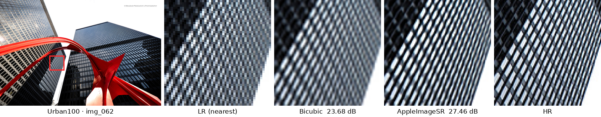
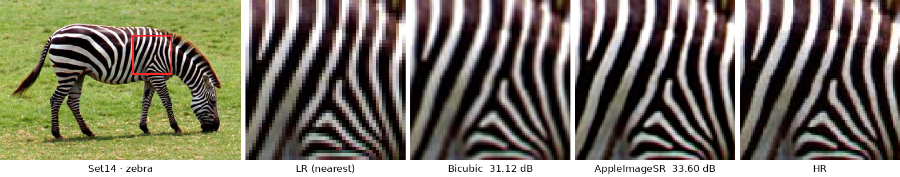
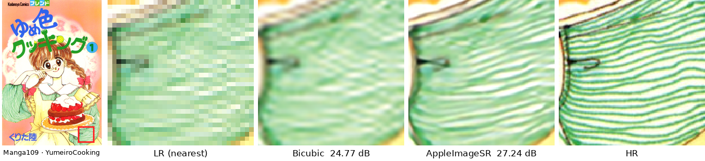
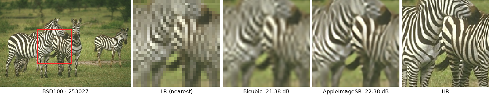
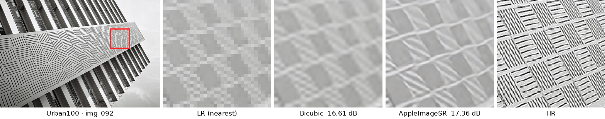
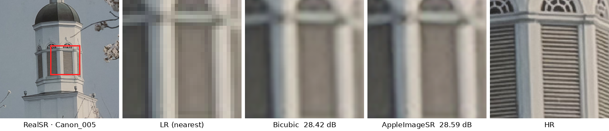

# AppleImageSR

PyTorch ports of Apple's `cnn_gp_mlscaler` (2x) and `cnn_gp_mlscaler4x` (4x) image
upscalers, converted from the CoreML programs shipped in the plaintext Apple
Intelligence visual assets (Image Playground upscaler).

## Structure

```
AppleImageSR/
├── model.py          # model definition + load_model(scale)
├── weights/
│   ├── cnn_gp_mlscaler_2x.pt
│   └── cnn_gp_mlscaler_4x.pt
├── example.py        # minimal inference example
├── assets/           # figures used below
└── requirements.txt
```

## Usage

```python
import torch
from model import load_model

model = load_model(4)                       # 2 or 4
x = torch.rand(1, 4, 256, 256)              # NCHW BGRA, values in [0, 1]
with torch.no_grad():
    y = model(x)                            # (1, 4, 1024, 1024)
```

```bash
pip install -r requirements.txt
python example.py
```

Input is BGRA, output is BGRA in `[0, 1]`. Spatial sizes are dynamic.

## Model

- ~3.57M parameters, fp32 weights
- Encoder: 3→64→128→256→512 with stride-2 3×3 convolutions
- Decoder: 2× bilinear upsampling with skip connections, 3×3 convolutions
- Output head: 3×3 conv → `pixel_shuffle(scale)` → 3×3 conv, plus an upsampled
  identity skip from the RGB input
- The 2x and 4x checkpoints differ in the `up_2` shape and the identity-skip
  weights (identity in the 2x model, learned 3×3 matrix in the 4x model)

## Validation against CoreML

CPU-only comparisons with the original `.mlmodelc` on random inputs:

| Model | Input | Output | PSNR | Mean abs error | Max abs error |
| --- | --- | --- | --- | --- | --- |
| 2x | 256×256 | 512×512 | 60.15 dB | 5.74e-4 | 7.56e-3 |
| 2x | 768×768 | 1536×1536 | 60.11 dB | 5.76e-4 | 8.60e-3 |
| 4x | 256×256 | 1024×1024 | 54.64 dB | 9.76e-4 | 2.00e-2 |
| 4x | 512×512 | 2048×2048 | 54.62 dB | 9.77e-4 | 2.26e-2 |
| 4x | 1024×512 | 4096×2048 | 54.60 dB | 9.80e-4 | 2.30e-2 |

The alpha channel matches exactly. Residuals come from fp16 CoreML storage and
accumulation order, not from model topology.

## Benchmarks

Results of the PyTorch port. The bicubic row is a reference baseline
(PyTorch `F.interpolate(mode="bicubic")`, which is slightly sharper than MATLAB
`imresize`, so bicubic scores here are a bit higher than the usual published numbers).

| Dataset | Images | Content |
| --- | --- | --- |
| Set5 | 5 | people, animals, butterfly |
| Set14 | 14 | natural images, people, texture |
| BSD100 | 100 | natural scenes, texture |
| Urban100 | 100 | buildings, repeated structures, regular texture |
| Manga109 | 109 | Japanese comics, line art, text |
| RealSR (crop) | 100 | real Canon/Nikon LR–HR pairs, 128→512 crops (StableSR split) |
| RealSR V3 | 100 | real Canon/Nikon LR–HR pairs, full test images |

### ×2

| Dataset | Method | PSNR-Y ↑ | SSIM-Y ↑ | MS-SSIM ↑ | LPIPS ↓ |
| --- | --- | --- | --- | --- | --- |
| Set5 | Bicubic | 33.98 | 0.9330 | 0.9928 | 0.1350 |
| | **AppleImageSR** | **36.53** | **0.9564** | **0.9955** | **0.0768** |
| Set14 | Bicubic | 30.55 | 0.8751 | 0.9858 | 0.2015 |
| | **AppleImageSR** | **32.66** | **0.9133** | **0.9918** | **0.1221** |
| BSD100 | Bicubic | 29.74 | 0.8496 | 0.9836 | 0.2728 |
| | **AppleImageSR** | **31.53** | **0.8942** | **0.9910** | **0.1693** |
| Urban100 | Bicubic | 27.07 | 0.8457 | 0.9830 | 0.2240 |
| | **AppleImageSR** | **30.35** | **0.9147** | **0.9918** | **0.1037** |
| Manga109 | Bicubic | 31.25 | 0.9386 | 0.9923 | 0.1111 |
| | **AppleImageSR** | **35.98** | **0.9715** | **0.9965** | **0.0418** |
| RealSR V3 | Bicubic | 31.75 | 0.8888 | 0.9547 | 0.2206 |
| | **AppleImageSR** | **32.18** | **0.8977** | **0.9568** | **0.1894** |

### ×4

| Dataset | Method | PSNR-Y ↑ | SSIM-Y ↑ | MS-SSIM ↑ | LPIPS ↓ |
| --- | --- | --- | --- | --- | --- |
| Set5 | Bicubic | 28.63 | 0.8138 | 0.9574 | 0.3451 |
| | **AppleImageSR** | **30.91** | **0.8755** | **0.9755** | **0.2271** |
| Set14 | Bicubic | 26.21 | 0.7088 | 0.9268 | 0.4414 |
| | **AppleImageSR** | **27.89** | **0.7658** | **0.9480** | **0.3318** |
| BSD100 | Bicubic | 26.05 | 0.6721 | 0.9154 | 0.5319 |
| | **AppleImageSR** | **27.09** | **0.7214** | **0.9375** | **0.4294** |
| Urban100 | Bicubic | 23.24 | 0.6616 | 0.9113 | 0.4740 |
| | **AppleImageSR** | **24.90** | **0.7459** | **0.9444** | **0.3179** |
| Manga109 | Bicubic | 25.07 | 0.7905 | 0.9422 | 0.3195 |
| | **AppleImageSR** | **28.33** | **0.8777** | **0.9693** | **0.1609** |
| RealSR (crop) | Bicubic | 27.15 | 0.7582 | 0.8713 | 0.4553 |
| | **AppleImageSR** | **27.51** | **0.7744** | **0.8796** | **0.4056** |
| RealSR V3 | Bicubic | 27.28 | 0.7658 | 0.8743 | 0.4732 |
| | **AppleImageSR** | **27.62** | **0.7801** | **0.8824** | **0.4397** |

On the bicubic-degraded benchmarks the model gains 1.0–4.7 dB over bicubic, most on
line art (Manga109) and regular structures (Urban100). For reference, ×4 Set5
(30.91 dB) sits between FSRCNN (30.72) and VDSR (31.35). On real camera
degradations (RealSR) the gain drops to ~0.4 dB, which suggests the model was
trained mainly for bicubic-like downsampling rather than real blur and noise.

Protocol:

- PSNR-Y / SSIM-Y on the Y channel (BT.601), `scale` border pixels cropped,
  outputs quantized to 8 bit (same as BasicSR)
- MS-SSIM ([pytorch-msssim](https://github.com/VainF/pytorch-msssim)) and
  LPIPS-Alex ([lpips](https://github.com/richzhang/PerceptualSimilarity)) on RGB,
  same border crop
- Set5/Set14/BSD100/Urban100/Manga109: BasicSR test sets (`GTmod{s}` /
  `LRbicx{s}`, MATLAB bicubic LR)
- RealSR (crop): `RealSRVal_crop128` from the StableSR test sets;
  RealSR V3: full Canon + Nikon `Test/{2,4}` images
- The encoder downsamples 3× by 2, so LR inputs are reflect-padded to a
  multiple of 8 and the output is cropped back. Inference is full-image
  (no tiling) in fp32 with TF32 disabled

### Visual comparison

The red box marks the zoomed region. It is placed automatically at the HR window
with the highest gradient energy, not chosen by which method looks better.
PSNR-Y is for the whole image.

**×2**




**×4**







## Provenance

Weights were extracted from Apple's plaintext CoreML assets and converted to
PyTorch state dicts. They remain Apple's property and are provided for private
research and interoperability testing only. Do not redistribute.
